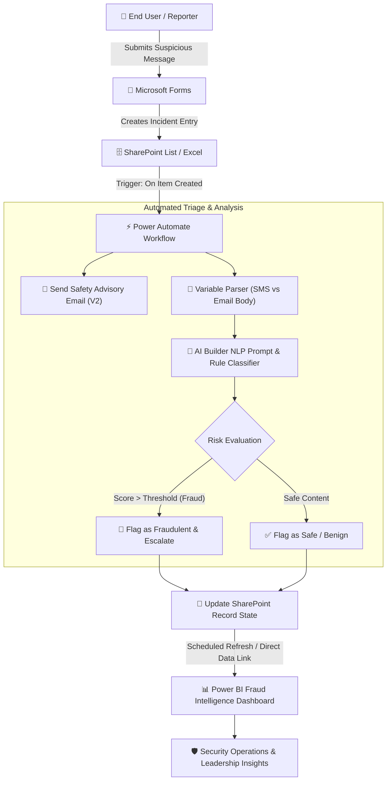

# 🛡️ AI-Powered Fraud Detection & Monitoring System (Low-Code / No-Code)

[](https://powerbi.microsoft.com/)
[](https://powerautomate.microsoft.com/)
[](https://learn.microsoft.com/en-us/ai-builder/)
[](https://www.microsoft.com/en-us/microsoft-365/sharepoint)
[](https://forms.microsoft.com/)
[](#tech-stack)

An enterprise-grade, **End-to-End Low-Code / No-Code Fraud Detection & Threat Intelligence System**. This solution automatically captures, validates, analyzes, and visualizes potentially fraudulent communications (SMS and Email phishing scams) in real time using **Microsoft Power Platform, AI Builder, SharePoint, and Power BI**.

---

## 📑 Table of Contents
- [📌 Project Overview](#-project-overview)
- [✨ Key Features](#-key-features)
- [🧩 Tech Stack & Ecosystem](#-tech-stack--ecosystem)
- [🔄 System Architecture & Data Flow](#-system-architecture--data-flow)
- [⚙️ Fraud Detection & AI Logic](#️-fraud-detection--ai-logic)
- [📸 System Walkthrough & Screenshots](#-system-walkthrough--screenshots)
  - [1. User Incident Reporting (Microsoft Forms)](#1-user-incident-reporting-microsoft-forms)
  - [2. Centralized Incident Store (SharePoint & Excel)](#2-centralized-incident-store-sharepoint--excel)
  - [3. Automated Orchestration & AI Builder Classification](#3-automated-orchestration--ai-builder-classification)
  - [4. Interactive Threat Intelligence Dashboard (Power BI)](#4-interactive-threat-intelligence-dashboard-power-bi)
- [📊 Dashboard Visual Analytics & KPIs](#-dashboard-visual-analytics--kpis)
- [📂 Repository Structure](#-repository-structure)
- [🚀 Setup & Deployment Guide](#-setup--deployment-guide)
- [🔮 Roadmap & Future Enhancements](#-roadmap--future-enhancements)
- [🤝 Contributing & Contact](#-contributing--contact)

---

## 📌 Project Overview

Modern cyber fraud targeting users via SMS (Smishing) and Email (Phishing) causes significant financial and identity losses. Traditional fraud prevention systems often require complex coding, dedicated server infrastructure, and high maintenance costs.

This project delivers a **scalable, fully automated, low-code/no-code alternative** that enables security operations and organizations to:
1. **Instantly Intake Reports:** Provide users with an intuitive incident submission interface.
2. **Automate Triage:** Trigger immediate automated acknowledgments, safety guidelines, and validation workflows.
3. **AI-Driven Threat Scoring:** Leverage AI Builder and configurable rule sets to analyze text patterns, urgency triggers, suspicious sender domains, and message codes.
4. **Drive Executive Visibility:** Provide security analysts and stakeholders with high-impact Power BI analytics dashboards tracking geographic trends, repeat offenders, and channel-wise threats.

---

## ✨ Key Features

- **⚡ Zero-Code End-to-End Automation:** Seamless orchestration across Microsoft Forms, SharePoint, Power Automate, and Power BI.
- **🤖 Generative AI / AI Builder Integration:** Context-aware classification of suspicious message text, body content, and sender details.
- **🚨 Instant Security Advisory Emails:** Automated notification engine that alerts reporters on safe handling practices (avoid clicking links, never disclose OTPs/credentials).
- **📈 Dynamic Real-Time Dashboards:** Multi-dimensional Power BI visualizations with interactive cross-filtering, maps, drill-downs, and trend metrics.
- **📍 Geographic Threat Mapping:** Pinpoint fraud incident density by region and location to identify targeted geographic campaigns.
- **🔍 Repeat Offender Tracking:** Identification and ranking of top suspicious email addresses and recurring malicious message codes.

---

## 🧩 Tech Stack & Ecosystem

| Component | Technology | Role & Functionality |
| :--- | :--- | :--- |
| **Intake Layer** | **Microsoft Forms** | Secure, mobile-responsive portal for collecting reported suspicious SMS & Email communications. |
| **Data Lake & Store** | **SharePoint Online / Excel** | Centralized, secure cloud tabular repository for incident tracking, auditing, and state storage. |
| **Logic & Automation** | **Power Automate** | Event-driven workflow engine executing data transformations, conditions, AI calls, and email alerts. |
| **Intelligence Layer** | **AI Builder / Rule Engine** | NLP prompt evaluation and heuristic logic to categorize items as *Fraudulent* or *Safe*. |
| **Analytics & BI** | **Microsoft Power BI** | Executive dashboards, threat intelligence monitoring, spatial maps, and KPI metric tracking. |

---

## 🔄 System Architecture & Data Flow



---

## ⚙️ Fraud Detection & AI Logic

The detection engine combines heuristic risk patterns with AI prompt evaluation:

1. **Channel Normalization:** Evaluates whether the submission is an **SMS** or **Email** and extracts the corresponding message payload (`Message_Description` vs `Message`).
2. **Immediate Warning Broadcast:** Dispatches an automated safety response advising the reporter:
   - Not to click any links or download attachments.
   - Never to disclose personal identification, banking details, or OTPs.
3. **AI Builder NLP Analysis:** Submits the extracted payload to an AI Builder prompt model designed to identify:
   - High-risk urgency indicators (*"Account suspended immediately"*, *"Action required in 24h"*).
   - Impersonation patterns (banks, parcel delivery, tax authorities).
   - Malicious URL structures and suspicious call-to-action triggers.
4. **Heuristic Rule Sets:**
   - High-risk sender email domain validation.
   - Suspicious message code tracking.
   - Anomaly detection based on repeated submissions from identical senders.
   - User confidence & feedback rating correlations.

---

## 📸 System Walkthrough & Screenshots

### 1. User Incident Reporting (Microsoft Forms)
Users can report suspicious communications through a responsive form capturing message type, sender details, message body, and location.

<p align="center">
  
</p>

---

### 2. Centralized Incident Store (SharePoint & Excel)
All incoming reports are automatically logged with timestamped fields, risk classifications, feedback scores, and metadata.

<p align="center">
  
</p>

---

### 3. Automated Orchestration & AI Builder Classification
The Power Automate pipeline triggers instantly on new list entries, parses content conditionally, executes AI Builder threat evaluation, and issues user safety guidance.

<p align="center">
  
</p>

<p align="center">
  
</p>

<p align="center">
  
</p>

---

### 4. Interactive Threat Intelligence Dashboard (Power BI)
Comprehensive Power BI dashboard providing deep visibility into threat metrics, geographic distributions, channel breakdown, and top threat vectors.

<p align="center">
  
</p>

<p align="center">
  
</p>

---

## 📊 Dashboard Visual Analytics & KPIs

The interactive Power BI dashboard delivers operational and executive metrics:

- **📊 SMS vs. Email Risk Breakdown:** Comparative visual of fraud prevalence across communication channels.
- **⚖️ Fraud vs. Safe Classification:** Real-time ratio of identified malicious attacks versus benign submissions.
- **🔢 Total Submission Volume:** Aggregate operational workload metric and platform engagement.
- **⭐ User Feedback & Confidence Scoring:** Reporter accuracy feedback to calibrate detection precision.
- **🗺️ Geographic Threat Map:** Spatial mapping of incidents by reported locations and regions.
- **🎯 Top 10 Malicious Senders:** Ranked list of high-frequency sender email IDs for blocklisting.
- **🏷️ Top 10 Message Codes & Indicators:** Identified scam templates, malicious patterns, and attack vectors.

---

## 📂 Repository Structure

```plaintext
Fraud-Detection-System/
├── 📊 FDS_DASHBOARD.pbix                     # Complete interactive Power BI report & data model
├── ⚡ Fraud Detection Flow.txt               # Step-by-step workflow logic & AI prompt definition
├── 📦 FraudDetectionFlow_20250829055341.zip # Exported Power Automate package ready for import
└── 📖 README.md                              # Comprehensive project documentation & visual guide
```

---

## 🚀 Setup & Deployment Guide

### Prerequisites
- Microsoft 365 Account with access to **Power Automate**, **SharePoint Online**, and **Forms**.
- **Power BI Desktop** (latest version) for opening and customizing `.pbix`.
- Microsoft **AI Builder** capacity/credits enabled in your Power Platform environment.

### Deployment Steps
1. **Create SharePoint List:**
   - Create a list with columns matching the form inputs (`Email_ID`, `How_the_message`, `Message_Description`, `Message`, `Status`, `Location`, `Feedback`).
2. **Import Power Automate Flow:**
   - Navigate to [Power Automate Portal](https://make.powerautomate.com/).
   - Import the package: `FraudDetectionFlow_20250829055341 (1).zip`.
   - Reconnect connections (SharePoint, Office 365 Outlook, AI Builder).
3. **Configure AI Builder Prompt:**
   - Verify prompt instructions and set output classification thresholds.
4. **Deploy Power BI Dashboard:**
   - Open [FDS_DASHBOARD.pbix](file:///c:/Users/DELL/Downloads/Fraud-Detection-System/FDS_DASHBOARD.pbix) in Power BI Desktop.
   - Update the SharePoint List URL in **Power Query Data Source Settings** to point to your live list.
   - Click **Refresh** and publish to Power BI Service.

---

## 🔮 Roadmap & Future Enhancements

- [ ] **Automated Firewall/Gateway Blocklisting:** Integrate Power Automate with Microsoft Defender / Exchange Online to auto-quarantine repeat offenders.
- [ ] **Multi-Language AI Support:** Expand AI Builder prompts to detect multi-lingual and localized phishing scams.
- [ ] **Teams/Slack SecOps Alerts:** Real-time push notifications into security team channels for critical-severity fraud reports.
- [ ] **Automated OCR for Screenshots:** Integrate Computer Vision to extract text directly from user-submitted scam screenshots.

---

<!-- ## 🤝 Contributing & Contact

Contributions, ideas, and suggestions are welcome! Feel free to open an issue or submit a pull request.
 -->

